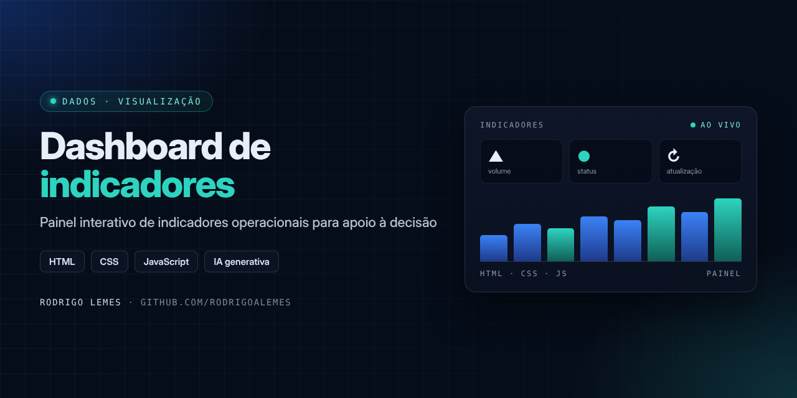
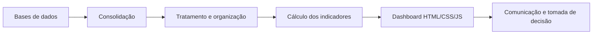

<p align="center">

</p>

<h1 align="center">Dashboard de Indicadores Operacionais</h1>
<p align="center"><i>Painel interativo para visualização de indicadores e apoio à decisão</i></p>

<p align="center">


</p>

## Sumário

- [Sobre](#sobre)
- [Problema e solução](#problema-e-solução)
- [Funcionalidades](#funcionalidades)
- [Como funciona](#como-funciona)
- [Tecnologias](#tecnologias)
- [Benefícios](#benefícios)
- [Estrutura do repositório](#estrutura-do-repositório)
- [Autor](#autor)

## Sobre

Dashboard interativo desenvolvido em **HTML, CSS e JavaScript**, com apoio de **IA generativa**, para visualização de **indicadores operacionais**. Envolve a consolidação, o tratamento e a organização de bases de dados para gerar indicadores que apoiam ações de comunicação institucional e a tomada de decisão.

> [!NOTE]
> Projeto desenvolvido em ambiente corporativo. O código-fonte e os dados não são publicados por conterem informações internas; este repositório documenta o problema, a solução e o funcionamento.

## Problema e solução

| | |
| --- | --- |
| **Problema** | Os dados operacionais estavam em bases separadas e sem uma visão consolidada para acompanhamento e decisão. |
| **Solução** | Consolidar e tratar as bases e apresentá-las em um painel web interativo, leve e fácil de compartilhar. |

## Funcionalidades

- Consolidação de diferentes bases de dados
- Tratamento e organização dos dados para os indicadores
- Visualização interativa no navegador
- Desenvolvimento assistido por IA generativa

## Como funciona



Detalhes: [Como funciona](docs/como-funciona.md)

## Tecnologias

| Tecnologia | Uso no projeto |
| --- | --- |
| HTML / CSS | Estrutura e layout do painel |
| JavaScript | Interatividade e montagem dos indicadores |
| IA generativa | Apoio no desenvolvimento e na organização dos dados |

## Benefícios

- Visão consolidada dos indicadores
- Apoio a ações de comunicação institucional
- Decisões baseadas em dados

## Estrutura do repositório

```text
dashboard-indicadores-operacionais/
├── assets/
│   └── capa.png
├── docs/
│   └── como-funciona.md
└── README.md
```

## Autor

**Rodrigo Lemes** · Analista de TI · Microsoft 365, AD/Entra ID, Automação, Power BI e IA aplicada

[](https://www.linkedin.com/in/rodrigoalemes/)
[](https://github.com/rodrigoalemes)
